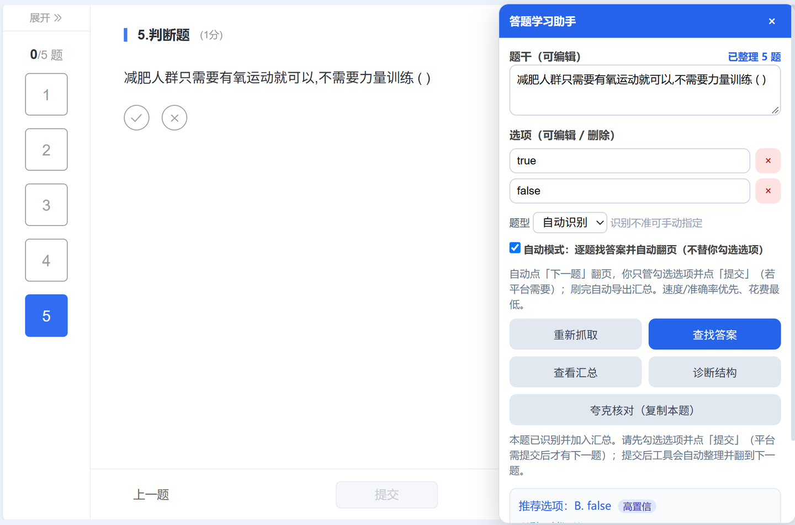
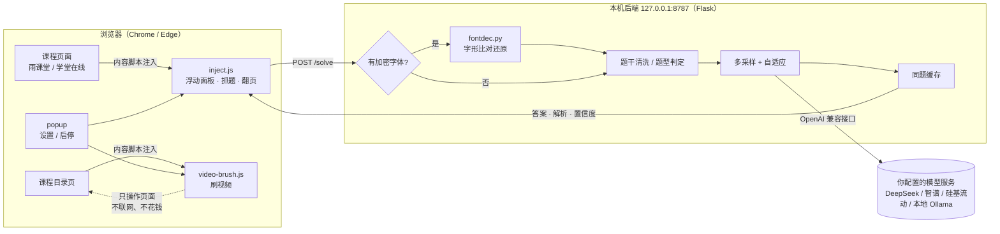

<div align="center">

# 答题学习助手

**Chrome 扩展 + 本地后端** · 抓题 → 还原加密字体 → 多采样问模型 → 只翻页、不代答

<sub>Manifest V3 · 后端只监听 127.0.0.1 · 支持任意 OpenAI 兼容接口</sub>


</div>

---

> **一句话**：在雨课堂 / 学堂在线这类课程页面上，它把题目抓下来、把加密字体还原成正常中文、把答案和解析整理成一份表；**只点「下一题」，不替你选选项、不提交试卷。**

> [!WARNING]
> 本项目仅用于**个人学习辅助**（核对答案、整理复习材料）。请遵守你所在学校与平台的用户协议，**不要用于考试作弊或代替独立完成作业**。作者不对使用后果负责。

---

## 目录

- [它能做什么](#它能做什么)
- [架构](#架构)
- [快速开始](#快速开始)
- [配置项](#配置项)
- [花多少钱](#花多少钱)
- [三个真正的难点](#三个真正的难点)
- [目录结构](#目录结构)
- [开发与测试](#开发与测试)
- [已知限制](#已知限制)
- [隐私](#隐私)
- [文档索引](#文档索引)
- [许可证](#许可证)

---

## 它能做什么

### 答题

| 能力 | 说明 |
| --- | --- |
| **抓题** | 自动识别题干、选项、题型（单选 / 多选 / 判断）；题目在 `iframe` 里也能抓对 |
| **加密字体还原** | 平台用自定义字体把题干显示成假字（DOM 里是乱码、屏幕上是正字），工具用字形比对把真字还原出来 |
| **多采样 + 自适应** | 默认并行问 2 次，结果一致就不再问第 3 次；分歧时追加一次复核裁决 |
| **只翻页、不代答** | 自动模式只点「下一题」，**不勾选选项、不提交**；答案按题号汇总给你自己看 |
| **汇总** | 按题目顺序输出题型、推荐答案、置信度、分歧标记与解析，可一键复制 |
| **成本可见** | 每答完一题就显示这一题花了多少钱，缓存命中显示 0 元 |

### 刷视频

| 能力 | 说明 |
| --- | --- |
| **从当前页开始** | 定位目录里当前选中的那条视频，前面的不回头 |
| **真播完才跳** | 只认播放器 `ended` / 进度到尾，不靠「距结尾 1.5 秒」猜 |
| **不重复刷** | 三层去重（节点 ID → 标题签名 → 已标 ✓），平台打勾后文本变了也不会再点一遍 |
| **进度卡住自愈** | 没暂停但时间不走时，依次尝试 `play()`、轻微 seek、提示手动接管 |
| **不伪造** | 不伪造心跳、不伪造学习时长、不改平台接口请求 |

> [!IMPORTANT]
> 刷视频**不需要启动后端、不消耗 API Key**，它只做「点开 → 播完 → 下一个」。

<!--
截图放这里：把图片放进 docs/screenshots/ 后取消下面的注释即可
<p align="center">
  
</p>
<p align="center"><sub>答题面板：推荐答案、置信度、解析与本题花费</sub></p>
-->

---

## 架构



关键点：**题目文字只发到你自己电脑上的 `127.0.0.1:8787`**，再由后端转发给你在 `.env` 里指定的那一家模型服务商。没有中间服务器，没有账号体系。

---

## 快速开始

### 0. 前置条件

- Chromium 内核浏览器（Chrome / Edge）
- Python **3.10 / 3.11**（安装时勾选 *Add Python to PATH*）
- 一个 OpenAI 兼容服务的 API Key（也可用本地 Ollama，完全免费）

### 1. 拿到代码

```bash
git clone https://github.com/<your-name>/quiz-assistant.git
cd quiz-assistant
```

### 2. 填 API Key

```bash
cd server
cp .env.example .env      # Windows: copy .env.example .env
```

用记事本打开 `server/.env`，把这一行填上：

```ini
OPENAI_API_KEY=sk-你的key
```

等号后**不要有空格、不要加引号**。其余保持默认即可，或参考 [配置项](#配置项) 换模型。

### 3. 启动后端

Windows 直接双击根目录的 **`start-server.bat`**（首次会自动装依赖，1–3 分钟）。

macOS / Linux：

```bash
cd server
python -m pip install -r requirements.txt
python app.py
```

看到这行就算成功：

```
 * Running on http://127.0.0.1:8787
```

> [!TIP]
> 这个窗口要一直开着。想确认 Key 有没有读到：浏览器打开 <http://127.0.0.1:8787/status>，`has_key: true` 即为正常。

### 4. 安装扩展

1. 地址栏打开 `chrome://extensions`
2. 右上角开启 **开发者模式**
3. 点 **加载已解压的扩展程序**
4. 选中本仓库的 **`extension` 文件夹**（是文件夹，不是里面的某个文件）

改完代码后：在 `chrome://extensions` 点卡片上的 ↻，再刷新题目页面。

### 5. 用

打开题目页，右下角出现浮动面板：

| 想做的事 | 操作 |
| --- | --- |
| 只看当前这题 | 点「查找答案」 |
| 整理整份作业 | 勾选「自动模式」：逐题查 → 只点下一题 → 结束给汇总 |
| 拿不准 | 点「夸克核对（复制本题）」，或把 `QA_SAMPLES` 调到 5 |
| 刷课程视频 | 在扩展弹窗点「从当前页开始刷」（不需要后端） |

详细操作见 [`docs/使用说明.md`](docs/使用说明.md)。

---

## 配置项

全部写在 `server/.env`，改完**重启后端**生效。

| 配置 | 默认 | 说明 |
| --- | --- | --- |
| `OPENAI_API_KEY` | 空 | **必填**（本地 Ollama 可留空） |
| `OPENAI_BASE_URL` | `https://api.openai.com/v1` | 任何 OpenAI 兼容地址，代码会自动拼 `/chat/completions` |
| `OPENAI_MODEL` | `gpt-4o-mini` | 模型 ID |
| `QA_SAMPLES` | `2` | 每题最多采样次数（1–5），越多越稳也越贵 |
| `QA_ADAPTIVE` | `1` | 自适应：先跑 2 次，一致就省掉后续；`0` 退回固定跑满 |
| `QA_MAX_TOKENS` | `800` | 单次输出上限（输出最贵也最慢，不建议调大） |
| `QA_VERIFY` | `1` | 答案分歧时追加一次复核裁决；多选与字体校对矛盾时必触发 |
| `QA_CACHE` | `1` | 同题答案缓存，重复刷同一份作业 0 元 |
| `QA_SEARCH` | `off` | 联网取证；国内中文搜索效果差，默认关闭 |
| `QA_SEARCH_TIMEOUT` | `4` | 单引擎超时秒数 |
| `QA_PRICE_IN` / `QA_PRICE_OUT` | `1.1` / `4.3` | 单价（元 / 百万 token），仅用于面板折算花费；免费模型填 `0` |
| `QA_THINKING` | 未设 | 设 `0` 关闭思考模式；换推理型模型时**必须**设，否则一题 10s+ 且更贵 |

### 换成便宜 / 免费的模型

| 方案 | `OPENAI_BASE_URL` | `OPENAI_MODEL` | 备注 |
| --- | --- | --- | --- |
| DeepSeek | `https://api.deepseek.com/v1` | `deepseek-flash` | 需同时 `QA_THINKING=0` |
| 智谱 | `https://open.bigmodel.cn/api/paas/v4` | `glm-4-flash` | 官方标注免费 |
| 硅基流动 | `https://api.siliconflow.cn/v1` | `Qwen/Qwen2.5-7B-Instruct` | 9B 以下免费 |
| 本地 Ollama | `http://localhost:11434/v1` | `qwen2.5:7b` | 全离线 0 元，建议 `QA_SAMPLES=1` |

---

## 花多少钱

面板每答完一题会直接写「用时 1.3s，¥0.0024」；汇总开头给出本次总花费。

实测（DeepSeek，5 道四选题受控 A/B）：

| 档位 | 模型调用 | 单题耗时 | 单题花费 | 50 题作业 |
| --- | --- | --- | --- | --- |
| 固定 3 采样（旧） | 3 次 | 1.82 s | ¥0.0043 | ≈ ¥0.22 |
| **默认（自适应 2+N）** | 2 次 | **1.31 s** | **¥0.0024** | **≈ ¥0.12** |
| `QA_SAMPLES=1` | 1 次 | ≈ 0.9 s | ≈ ¥0.0012 | ≈ ¥0.06 |
| 同题缓存命中 | 0 次 | 0 s | ¥0 | ¥0 |

- 按「未命中缓存」算，属偏高估计；
- 换免费模型或本地 Ollama 即为 0 元；
- 缓存存在 `server/cache/answers/`，删掉会重新花钱，**清理时注意**。

---

## 三个真正的难点

这部分才是项目有意思的地方，细节见 [`docs/ARCHITECTURE.md`](docs/ARCHITECTURE.md)。

### 1. 加密字体：DOM 里是乱码，屏幕上是正字

平台把题干塞进 `<span class="xuetangx-com-encrypted-font">`，用的是一份重映射过的字体（675 KB 级别）。工具的做法：

1. 抓下字体，用 `fontTools` 取出每个字形的轮廓；
2. 用**同源参考字体**（`server/fonts/NotoSansSC-VF.ttf`，思源黑体，17 MB）在 64 / 96 / 112 三个字号下渲染成位图，逐字比对；
3. 取平均拟合分最高的映射，生成 `密文 → 真字` 表。

**踩过的坑**：早期整段套映射，把 span 外面的正常中文也一起替换了，于是「正常题干」变成乱码。现在按**文本节点**判断是否加密，只对加密节点套映射；并加了质量闸门（`missRatio > 0.2` 或 `avg_score < 0.85` 判失败），失败就**拒绝作答**而不是瞎猜。

### 2. 抓错元素：抓到课程目录，还抓到反自动化诱饵

页面里塞了 `position:fixed; left:-10000px` 的假选项和假「下一题」，专门钓自动化脚本。工具的做法：

- `isVisible()` 要求元素必须与视口有交集，屏幕外的假元素直接排除；
- `isDecoy()` 识别 `data-automation-risk-decoys` 等标记；
- `pickQuestionRoots()` 按「有 `.problem-body` / 有加密字体 / 有选项控件」打分，只保留最像题的那一层（优先 `iframe`）；
- 翻页前过 `isCurrentValid()` 闸门：题干空、太短、像课程目录、选项少于 2 个 → **不翻页**，重抓。

### 3. 播放器倍速与「看起来播完」

平台播放器会在 `timeupdate` 里把 `playbackRate` 改回去，硬顶会互相打架，导致 `currentTime` 卡死。因此：

- 1x 时**完全不碰播放器**（不写 `playbackRate`、不挂监听、不点倍速菜单）；
- >1x 才启用，节流 400 ms，被改回 5 次以上就退回 1x；
- 判定「播完」只认 `ended` / 进度到尾，且要停留等平台心跳上报。

> [!NOTE]
> 多数平台按**真实观看时长**计完成度，2x 只会计约一半。想刷满请用 1x。

---

## 目录结构

```
quiz-assistant/
├── extension/               # 浏览器扩展（加载这个文件夹）
│   ├── manifest.json
│   ├── inject.js            # 答题面板：抓题 / 解码 / 翻页 / 汇总
│   ├── video-brush.js       # 刷视频：目录定位 / 播放控制 / 去重
│   ├── background.js
│   └── popup.html / popup.js
├── server/                  # 本地后端
│   ├── app.py               # Flask：/solve /decode /status /debug
│   ├── fontdec.py           # 加密字体字形比对
│   ├── requirements.txt
│   ├── .env.example         # 配置模板（复制成 .env）
│   └── fonts/
│       ├── NotoSansSC-VF.ttf  # 参考字体（OFL 1.1）
│       ├── OFL.txt
│       └── README.txt
├── tests/                   # 端到端 + 单元测试
├── docs/                    # 文档
├── start-server.bat         # Windows 一键启动
├── check-config.bat         # 配置自检
├── LICENSE
└── README.md
```

运行时产物（不进版本库）：`server/cache/`（答案 + 字体缓存）、`server/debug/`（诊断）、`server/reports/`（汇总）。

---

## 开发与测试

```bash
# 后端单元测试（需要 Windows 系统字体 simsun.ttc 来造「假加密字体」）
py -3 tests/decode.test.py
py -3 tests/backend_decode.test.py

# 浏览器端到端测试（需要本机 Chrome，走 CDP）
node tests/autorun.e2e.mjs
node tests/videobrush.e2e.mjs
node tests/iframeroot.e2e.mjs
node tests/decode.e2e.mjs
```

测试使用本地 mock 页面（`tests/mock-exam*.html`、`tests/mock-course.html`）复现平台结构，覆盖加密字体混排、反自动化诱饵、iframe 嵌套、播放器卡进度等场景，不依赖真实平台账号。GitHub Actions 只跑语法、版本一致性与密钥扫描，端到端测试需在本地跑。

打包发布：

```bash
python tests/pack_release.py 0.9.27
```

约定与提交流程见 [`CONTRIBUTING.md`](CONTRIBUTING.md)。

---

## 已知限制

- **不保证答案正确**。模型会错，形近字偶尔会还原错；低置信与分歧会在面板标出，请自己判断。
- **只适配了雨课堂 / 学堂在线**的页面结构。其它平台需要改 `inject.js` 的选择器；抓不到时点面板「诊断结构」，会导出 `server/debug/debug-*.json` 便于适配。
- **主观题、计算题、图表题**效果差，建议自己看。
- **依赖平台前端结构**，平台改版就可能失效，这属于常态维护。
- 刷视频**需要标签页在前台**，后台标签会被浏览器节流。

---

## 隐私

- API Key 只存在你本机的 `server/.env`；仓库里只有 `.env.example` 占位符，**从未有任何真实密钥进过版本库**；
- 题目文字 → `127.0.0.1:8787` → 你配置的模型服务商，不经第三方；
- 抓题、解码、翻页、汇总全在本机完成；
- `server/reports/` 里的汇总副本仅用于「合并报告」，不外发。

---

## 文档索引

| 文件 | 内容 |
| --- | --- |
| [`docs/使用说明.md`](docs/使用说明.md) | 完整操作手册、常见问题、花费说明 |
| [`docs/ARCHITECTURE.md`](docs/ARCHITECTURE.md) | 架构、数据流、关键算法与设计取舍 |
| [`docs/DEVLOG.md`](docs/DEVLOG.md) | 逐版本开发日志（每个 bug 的根因与修法） |
| [`CHANGELOG.md`](CHANGELOG.md) | 版本变更摘要 |
| [`CONTRIBUTING.md`](CONTRIBUTING.md) | 如何参与开发、测试与提交 |

---

## 许可证

代码采用 [MIT](LICENSE)。

内置参考字体 `server/fonts/NotoSansSC-VF.ttf`（Noto Sans SC / 思源黑体）采用 **SIL Open Font License 1.1**，允许随本软件再分发，全文见 [`server/fonts/OFL.txt`](server/fonts/OFL.txt)。

---

<div align="center">
<sub>如果这个项目帮你省下了重复劳动，欢迎点个 Star ⭐</sub>
</div>
